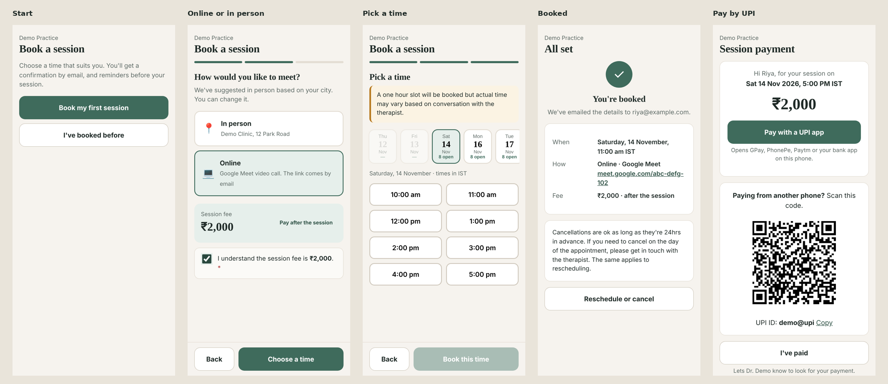
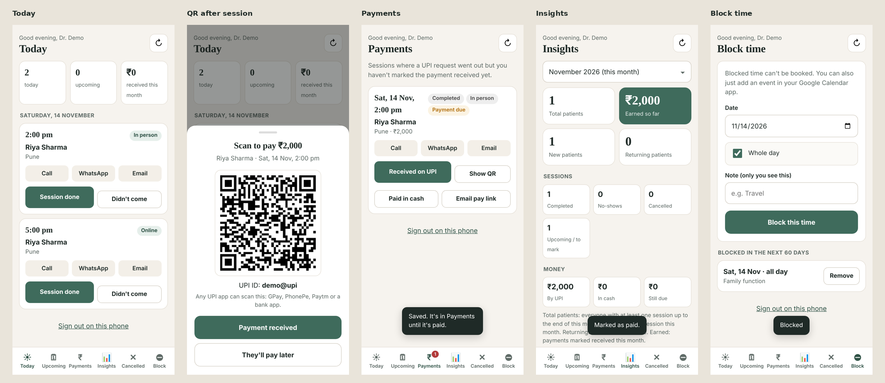

# Scheduling App Prototype

A free, phone-first booking app for a solo practitioner (therapist, coach, consultant). It runs entirely on a free Google account: Google Sheets for data, Apps Script for the app, Google Calendar for availability, Google Meet for online sessions and Gmail for emails. There are no monthly fees and no server to manage.

**How it was built:** with Claude as the coding assistant. I defined the users and requirements, made the design decisions and ran the tests.





## What it does

**For patients (phone browser, no app to install)**
- Book a session: name, location, phone and email, privacy consent, online or in person (suggested from their city), fee acknowledgement, then pick an open time.
- Returning patients enter their email or phone number and get a 6-digit code by email, so they don't fill in their details again.
- Confirmation email with a Google Meet link or the clinic address, the cancellation policy and a calendar file.
- Reminder emails 2 hours and 30 minutes before.
- Reschedule or cancel online with a reason, up to a cut-off (default 24 hours).
- Pay after the session: a UPI page with a pay button, a QR code and the UPI ID.

**For the therapist (PIN-protected page, can be added to the phone's home screen)**
- Today, Upcoming, Payments, Insights, Cancelled and Block-time tabs.
- **Session done:** show a UPI QR on screen, email a UPI payment link, or record cash. Mark no-shows and mark payments received.
- One-tap Call, WhatsApp or Email for each patient.
- **Insights by month:** total, new and returning patients, earnings (UPI and cash), sessions, no-shows, cancellations and payments due. The same figures appear on a Dashboard tab in the Sheet.
- Email alerts for new bookings, changes and payments, plus Google Calendar pop-ups before each session.

**Settings** (a tab in the Sheet, no code changes needed): fee, working days and hours, session length, buffer between sessions, daily cap, notice period, booking window, in-person cities, UPI ID, contact details, and the policy and privacy text.

## Install

See [docs/INSTALL.md](docs/INSTALL.md). In short: create a Google Sheet, paste `dist/Code.gs` and `dist/appsscript.json` into **Extensions ▸ Apps Script**, run `setup`, then deploy as a web app.

## Project layout

```
dist/      single-file build to paste into Apps Script (Code.gs + appsscript.json)
src/       the same app as separate files (server code + HTML pages); build.py bundles them into dist/
docs/      install guide
screenshots/
```

## Limits of the free setup
- **Email cap:** a free Gmail account can send to about 100 recipients a day from scripts, which is enough for roughly 14 sessions a day.
- **Banner:** Google shows a small "created by a Google Apps Script user" banner on the pages.
- **Payments:** they go straight to the UPI ID, and the therapist confirms each one in the app. There's no automatic payment matching.

## Privacy and DPDP
No personal data lives in this code. Everything below is stored only in the installer's own Google Sheet. In India, the DPDP Act's notice, consent, erasure and breach-reporting duties apply from 13 May 2027, so the open items should be closed before real patients use the app.

| Area | Today | Open item |
|---|---|---|
| Personal data held | Name, phone, email, city, session history, payment status | Therapy bookings can reveal health context, so treat the whole Sheet as sensitive |
| Notice and consent | Required consent tick box with a privacy notice before booking | The notice is a placeholder; replace it with text reviewed by a lawyer |
| Retention | Kept until the practitioner deletes it | Set a retention period and remove or anonymise past patients |
| Correction and erasure | Manual, in the Sheet | Add a request path for patients to correct or delete their data |
| Children | No age check | Add an age question; under-18s need verifiable parental consent |
| Access | PIN-protected admin page; data in one Google account | Turn on 2-step verification for that account |
